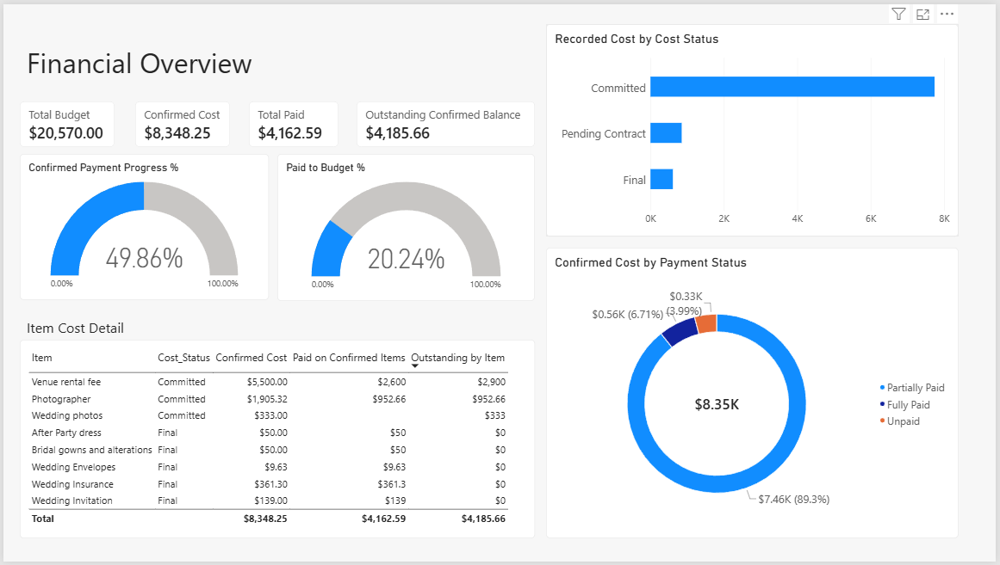
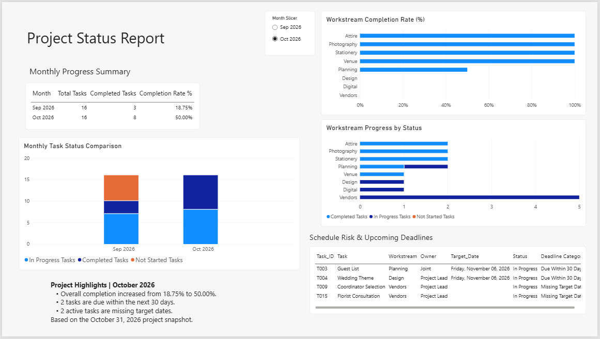
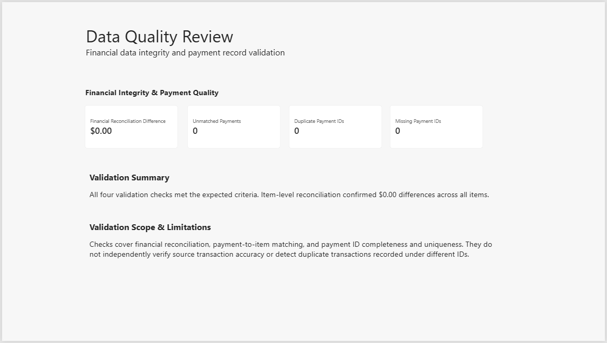
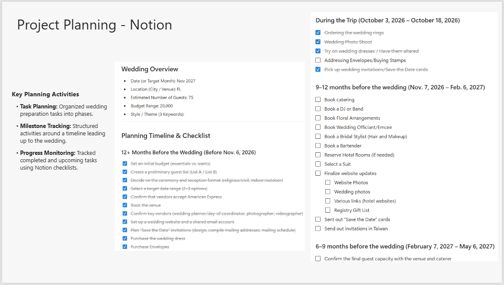
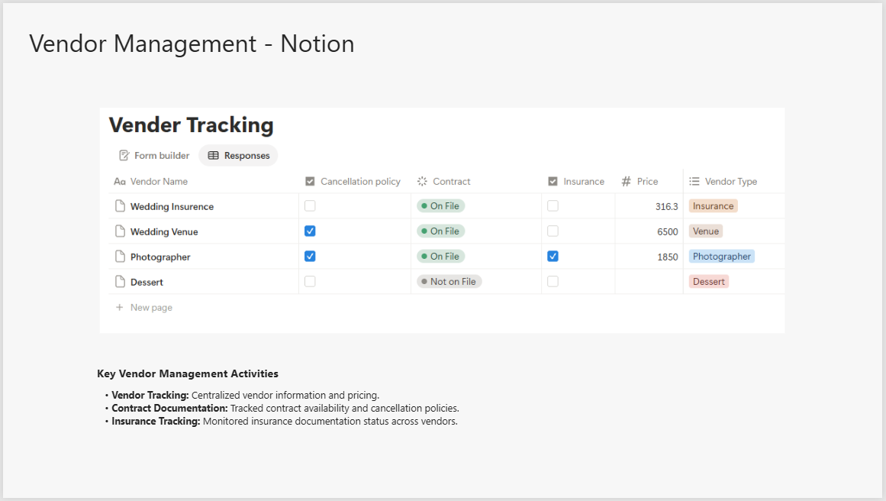

# Wedding Project Management Portfolio

### Project Planning | Vendor Management | Financial Monitoring | Power BI Reporting

## Project Overview

This independent project demonstrates the application of project management practices to planning and coordinating a wedding scheduled for November 2027 in Florida, with approximately 75 guests.

The project integrates **Notion, Microsoft Excel, and Power BI** to support structured planning, vendor coordination, budget management, progress monitoring, and data quality validation.

The portfolio highlights how planning documentation, operational records, and reporting tools can be used together to support project execution and informed decision-making.

## Project Objectives

- Develop a structured project plan with phased tasks and milestones.
- Track vendor information, contract documentation, and insurance requirements.
- Monitor project progress, upcoming deadlines, and outstanding activities.
- Manage budget allocations, confirmed costs, and payment records.
- Validate financial data consistency and identify potential discrepancies.

## Tools & Applications

| Tool | Application |
|---|---|
| **Notion** | Project planning, task checklists, vendor tracking, and contract documentation |
| **Microsoft Excel** | Budget management, payment records, vendor evaluation, and operational planning |
| **Power BI** | Financial reporting, project status monitoring, and data quality review |
| **Power Query** | Data cleaning, transformation, and preparation |
| **DAX** | KPI calculations, financial reconciliation, and project status measures |

## Project Management Approach

### 1. Project Planning & Task Management

Developed a phased planning checklist in Notion to organize wedding preparation activities across different stages of the project lifecycle.

**Key Activities:**
- Organized tasks into time-based planning phases.
- Structured activities around upcoming milestones and deadlines.
- Tracked completed and outstanding tasks using Notion checklists.
- Included event preparation and post-event activities in the planning timeline.

### 2. Vendor Management & Documentation

Used a centralized Notion database to organize vendor-related information and track documentation requirements.

**Key Activities:**
- Maintained vendor categories and pricing information.
- Tracked contract document availability.
- Recorded cancellation policy and insurance documentation status.
- Organized vendor-related records to support coordination and follow-up.

### 3. Budget & Financial Management

Maintained Excel-based budget and payment records and developed a Power BI financial dashboard to monitor project expenditures and payment progress.

**Key Metrics:**
- Total Budget
- Confirmed Cost
- Total Paid
- Outstanding Confirmed Balance
- Confirmed Payment Progress

### 4. Project Status Monitoring

Developed a Power BI project status report using monthly task snapshots to monitor project progress.

**Key Metrics:**
- Task Completion Rate
- Completed, In Progress, and Not Started Tasks
- Overdue Tasks
- Upcoming Deadlines (30 Days)
- Tasks with Missing Target Dates

### 5. Data Quality Validation

Implemented Power BI validation measures to monitor data consistency and identify discrepancies in financial and payment records.

**Validation Checks:**
- Financial Reconciliation Difference
- Unmatched Payments
- Duplicate Payment IDs
- Missing Payment IDs

These checks support the reliability of financial reporting and help identify issues that require review.

---

## Power BI Portfolio

The Power BI report contains five pages covering financial performance, project progress, data quality, and supporting planning documentation.

### Page 1 — Financial Overview

Tracks the project's financial position, including budget allocations, confirmed costs, completed payments, and outstanding balances.

### Page 2 — Project Status Report

Presents monthly task status snapshots, completion progress, upcoming deadlines, and overdue activities.

### Page 3 — Data Quality Review

Displays financial reconciliation and payment data validation checks to support reporting accuracy.

### Page 4 — Project Planning (Notion)

Demonstrates phased project planning, task organization, and checklist-based progress tracking maintained in Notion.

### Page 5 — Vendor Management (Notion)

Demonstrates centralized vendor documentation tracking, including contract availability, cancellation policies, insurance records, and pricing.

---

## Repository Contents

| File | Description |
|---|---|
| `Wedding_Project_Public_Data.xlsx` | Excel workbook containing budget, payment, project status, vendor, and operational planning records |
| `Wedding_Project_Management_Portfolio.pbix` | Five-page Power BI report |
| `screenshots-01-financial-overview.png` | Financial Overview dashboard |
| `screenshots-02-project-status.png` | Project Status Report dashboard |
| `screenshots-03-data-quality.png` | Data Quality Review dashboard |
| `screenshots-04-project-planning.png` | Notion Project Planning documentation |
| `screenshots-05-vendor-management.png` | Notion Vendor Management documentation |

## Data Notes & Limitations

- **Ongoing Project:** This portfolio reflects an active wedding planning project. Costs, task statuses, and planning details may change as the project progresses.
- **Reporting Snapshots:** Project status reporting uses monthly snapshots rather than real-time task synchronization.
- **Notion Integration:** Notion screenshots represent static planning documentation and are not live-connected to Power BI.
- **Budget Baseline:** The Notion planning overview displays an initial budget range of $20,000, while the Power BI financial report reflects a more detailed working budget of $20,570.
- **Data Privacy:** Public-facing vendor information has been anonymized, and private contract attachments are not included in the published materials.

## How to Explore This Portfolio

- **Quick Preview:** View the five report screenshots directly in this README.
- **Power BI Report:** Download `Wedding_Project_Management_Portfolio.pbix` and open it using Power BI Desktop.
- **Excel Workbook:** Download `Wedding_Project_Public_Data.xlsx` to explore the underlying planning and financial records.
- **Data Source Configuration:** If Power BI requires a data source update, use **Transform Data → Data Source Settings** to replace the original local Excel file path with the downloaded workbook location, then refresh the report.

The report screenshots provide a static preview without requiring Power BI Desktop.

## Project Management Skills Demonstrated

- Project Planning & Task Organization
- Milestone & Deadline Tracking
- Vendor Coordination & Documentation Management
- Budget & Payment Monitoring
- Project Status Reporting
- Data Quality Validation
- Cross-Tool Workflow Integration

---

*This is an independent project management portfolio developed to demonstrate practical planning, coordination, monitoring, and reporting skills.*
